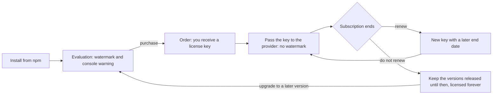

# Licensing

Meridiana is commercial software, published on npm. Anyone can install it; the license key turns an
evaluation copy into a licensed one. The terms are in [`LICENSE.md`](../LICENSE.md); this page
explains how the key works.

## The license lifecycle



1. **Evaluation.** Without a key, every view works fully but shows a banner at its top, with the
   reason and the contact, and a large diagonal "Meridiana · unlicensed" across it; neither blocks
   clicks, drag or scroll. The console shows one warning. You may evaluate for 30 days, in
   a non-production environment only.
2. **Purchase.** The order states the licensee, the number of developers and the subscription
   period. With it you receive a license key.
3. **Licensed use.** Pass the key to the provider (below). The watermark and the warning disappear.
   One key covers all your developers and all your applications under the order.
4. **End of the subscription.** The key stays valid **forever** for every version of Meridiana
   released up to the last day of the subscription. Applications already built never break.
5. **Renewal.** Renew to use the versions released later: you receive a new key with a later end
   date. Replace the old key with it.
6. **Upgrading without renewing.** A version released after the end of the subscription treats the
   key as expired and shows the watermark again, with the end date in the banner. Stay on an earlier
   version, or renew.

## Using the key

```ts
// Angular
provideMeridiana({ licenseKey: environment.meridianaKey });
```

```tsx
// React and React Native
<MeridianaProvider licenseKey={import.meta.env.VITE_MERIDIANA_KEY}>…</MeridianaProvider>
```

Or call `setLicenseKey(key)` from `@moobitech/meridiana-core` before the first calendar renders.

Keep the key out of public repositories: read it from your environment or build configuration. A
key in a web bundle can be read by whoever opens the page; this is expected and allowed, but do not
publish it anywhere else.

## How the check works

- The key is a signed token: `<payload>.<signature>`. The payload holds the order id, the licensee,
  the last day of the subscription and the number of developers; the signature is Ed25519, made with
  the private key of Moobi Tech. Meridiana checks it against the public key it embeds.
- Every version of Meridiana knows its release date (`MERIDIANA_RELEASE_DATE`). The key is valid
  when the signature matches and the release date is not after the end of the subscription.
- The check runs **on the device, offline**: Meridiana never calls a server and sends no data.
- `getLicenseStatus()` returns the result: `valid`, `missing`, `invalid` or `expired`, with the
  licensee and the end date of a signed key.

| Status | Meaning | What you see |
| --- | --- | --- |
| `valid` | signed key, this version is covered | nothing |
| `missing` | no key set | watermark and one console warning |
| `invalid` | not a Meridiana key, or edited | watermark and one console warning |
| `expired` | signed key, this version was released after the subscription ended | watermark and one console warning, with the end date |

## Questions

- **Lost key?** Write to the contact in [`LICENSE.md`](../LICENSE.md) with your order id.
- **More developers?** The order is updated; the key does not change, unless the subscription
  period changes too.
- **A key that leaked?** Tell us without delay. Keys cannot be revoked remotely, as the check is
  offline: we issue you a new key and stop renewing the old one.
