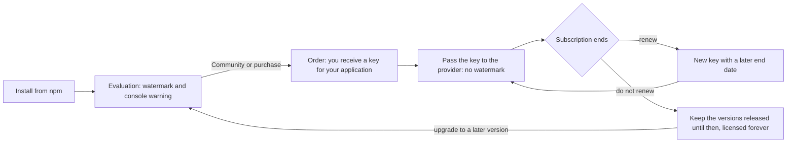

# Licensing

Meridiana is commercial software, published on npm, with a free Community plan for the web views.
Anyone can install it; the license key, free or paid, turns an evaluation copy into a licensed one,
for one application. The terms are in [`LICENSE.md`](../LICENSE.md), the plans in
[Pricing](pricing.md); this page explains how the key works.

## The license lifecycle



1. **Evaluation.** Without a key, every view works fully but shows a banner at its top, with the
   reason and a link to [Pricing](pricing.md), and a large diagonal "Meridiana · unlicensed" across
   it. Only the link takes clicks: neither blocks clicks, drag or scroll on the view. The console
   shows one warning. You may evaluate for 30 days, in a non-production environment only.
2. **Order.** Request a free Community key or a license from [Pricing](pricing.md). The order
   states the licensee, the plan, the products, the application with its hosts and bundle ids, and
   the subscription period. With it you receive a license key.
3. **Licensed use.** Pass the key to the provider (below). The watermark and the warning disappear
   on the hosts and bundle ids of your application. One key covers all your developers.
4. **End of the subscription.** The key stays valid **forever** for every version of Meridiana
   released up to the last day of the subscription. Applications already built never break.
5. **Renewal.** Renew, at a discount (see [Pricing](pricing.md#renewals)), to use the versions
   released later: you receive a new key with a later end date. Replace the old key with it.
6. **Upgrading without renewing.** A version released after the end of the subscription treats the
   key as expired and shows the watermark again, with the end date in the banner. Stay on an earlier
   version, or renew.

## Using the key

```ts
// Angular
provideMeridiana({ licenseKey: environment.meridianaKey });
```

```tsx
// React and React Native
<MeridianaProvider licenseKey={import.meta.env.VITE_MERIDIANA_KEY}>…</MeridianaProvider>
```

Or call `setLicenseKey(key)` from `@moobitech/meridiana-core` before the first calendar renders.

Keep the key out of public repositories: read it from your environment or build configuration. A
key in a web bundle can be read by whoever opens the page; this is expected and allowed, but do not
publish it anywhere else.

## How the check works

- The key is a signed token: `<payload>.<signature>`. The payload holds the order id, the licensee,
  the last day of the subscription, the plan, the products (`web`, `native`, `timeline`) and the
  application: its hosts and bundle ids. The signature is Ed25519, made with the private key of Moobi
  Tech. Meridiana checks it against the public key it embeds.
- Every version of Meridiana knows its release date (`MERIDIANA_RELEASE_DATE`). The key is valid
  when the signature matches, the release date is not after the end of the subscription, the key
  covers the product of the views (the Angular and React views are `web`, the React Native views
  `native`) and the application is one of its own.
- The application is the host of the page on the web (`location.hostname`) and the bundle id the
  system reports on iOS and Android (`expo-application`). `*.example.com` in the key covers
  `example.com` and its subdomains. `localhost`, `*.localhost`, `127.0.0.1`, `::1` and Expo Go always
  work, for development; addresses of the local network do not, unless the key lists them.
- When the host is unknown, as in server-side rendering, the application is not checked: the
  browser checks it again.
- The check runs **on the device, offline**: Meridiana never calls a server and sends no data.
- `getLicenseStatus({ product, app })` returns the result, with the licensee, the plan and the end
  date of a signed key. Without arguments it checks the web views on the host of the page.

| Status | Meaning | What you see |
| --- | --- | --- |
| `valid` | signed key, this version is covered | nothing |
| `missing` | no key set | watermark and one console warning |
| `invalid` | not a Meridiana key, or edited | watermark and one console warning |
| `expired` | signed key, this version was released after the subscription ended | watermark and one console warning, with the end date |
| `wrong-app` | signed key, for another application | watermark and one console warning, with the host or bundle id |
| `missing-product` | signed key, its plan does not include these views (for example React Native with a Web plan) | watermark and one console warning |

## Questions

- **Lost key?** Write to the contact in [`LICENSE.md`](../LICENSE.md) with your order id.
- **More developers?** Nothing to do: every plan covers all your developers (Community: at most 5 in
  a company).
- **A new host or bundle id for the same application?** Ask for a new key, free.
- **Another application?** It needs its own license and key.
- **A key that leaked?** Tell us without delay. Keys cannot be revoked remotely, as the check is
  offline: we issue you a new key and stop renewing the old one.
